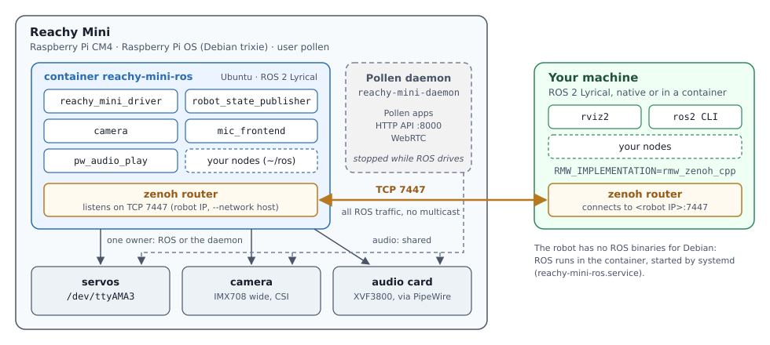
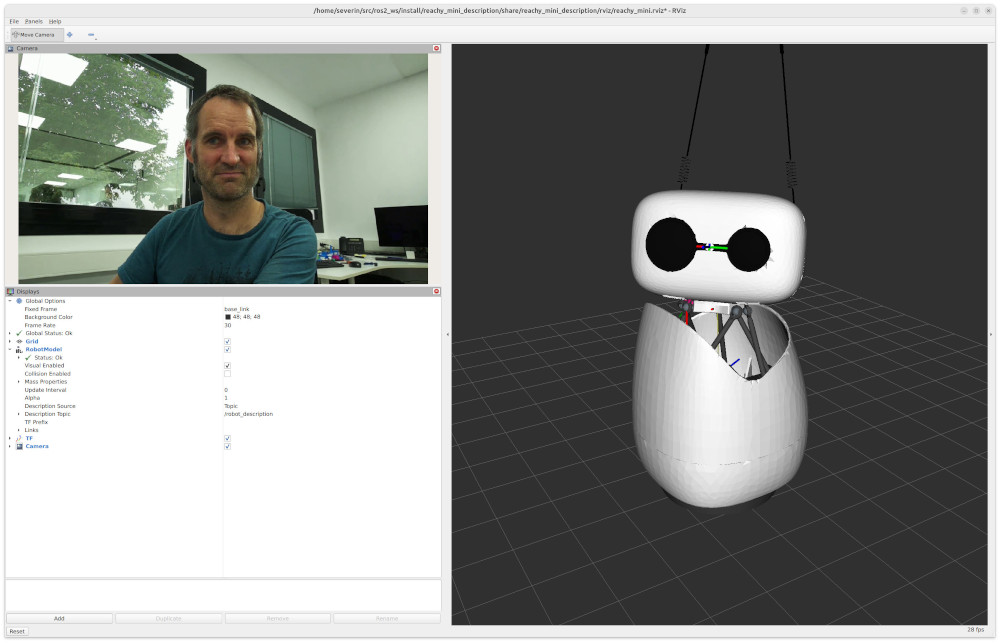

# Reachy Mini ROS 2

ROS 2 Lyrical support for the Pollen Robotics Reachy Mini (wireless): the
servos, the robot model and TF, the camera, the microphones and the speaker, and
the [ROS4HRI skills](https://ros4hri.github.io/skills/) (`replay_motion`,
`look_at`, ...), all as ROS nodes that run on the robot and own the hardware
directly, without the Pollen daemon.

This page follows the main path:

1. **[Installation](#1-installation-turn-a-reachy-mini-into-a-ros-robot)**: take
   an off-the-shelf Reachy Mini and make it a ROS robot, keeping the Pollen
   daemon as the default or making ROS the default;
2. **[Usage](#2-usage)**: start ROS on the robot, connect your own machine to it
   over zenoh, open RViz;
3. **[Tests](#3-tests-is-everything-working)**: check in a few minutes that
   everything works.

The interface of the nodes (parameters, topics, skills, TF), the camera and audio
details, native and from-source installations are in
**[REFERENCE.md](REFERENCE.md)**; why the driver is built the way it is, in
**[DESIGN.md](DESIGN.md)**.

## How the pieces fit



The robot runs Debian trixie, which has no ROS 2 Lyrical binaries, so ROS runs
there in an Ubuntu-based Docker container (image built from
[`docker/Dockerfile`](docker/Dockerfile)). All ROS traffic uses
`rmw_zenoh_cpp`: the container runs a zenoh router on port 7447, and your machine
runs a second router that connects to it (no multicast, so it works from a
container or through a NAT too).

Only one process can own the servos and the camera: either the Pollen daemon
(Pollen's apps, HTTP API, WebRTC) or the ROS driver. The installation lets you
pick which one starts at boot.

## 1. Installation: turn a Reachy Mini into a ROS robot

Everything happens over ssh; nothing is flashed. Allow 10 minutes plus the image
download.

### 1.1 What you need

* The robot powered, on the same network as your machine, onboarded once with
  Pollen's app (so it has a hostname and joins the WiFi).
* Its hostname or IP: `reachy-mini.local` for a single robot, otherwise
  `reachy-mini-XXXX.local` (mDNS), or the IP shown by the Pollen app or your
  router.
* The `pollen` account on the robot, which has `sudo`. Its default password
  is `root`.

### 1.2 Log in and check the clock

```sh
ssh pollen@reachy-mini.local
date -u
```

The robot has no battery-backed clock, so the date drifts after a long power-off
and `apt` then refuses the repositories ("Not live until ..."). The clock must
also agree with your machine's to within 500 ms, otherwise zenoh rejects the
robot's messages.

The package of section 1.3 sets up an NTP server that answers on networks
where the Debian pool is blocked (the IIIA's included), but `apt` must work to
install it. If the date is wrong, copy your machine's clock first (accurate to
about a second, enough for `apt`; NTP does the rest once the package is in):

```sh
# from your machine
ssh -t pollen@reachy-mini.local "sudo date -u -s '$(date -u)'"
```

Your own machine's clock must be right too (a container uses its host's clock).

### 1.3 Install the bootstrap package

[reachy-mini-ros2-bootstrap](https://gitlab.iiia.csic.es/socialminds/robots/reachymini/reachy_mini_ros2_bootstrap)
is a Debian package that sets up the robot for ROS: it installs Docker,
configures PipeWire and NTP, and installs the systemd unit that keeps the ROS
container running, pulling its image on first start. It comes from the
SocialMinds apt repository. On the robot:

```sh
# the SocialMinds apt repository
sudo mkdir -p /etc/apt/keyrings
curl -fsSL https://socialminds.doc.iiia.csic.es/apt/public.key \
  | gpg --dearmor | sudo tee /etc/apt/keyrings/socialminds.gpg > /dev/null
echo "deb [signed-by=/etc/apt/keyrings/socialminds.gpg] https://socialminds.doc.iiia.csic.es/apt/ lyrical main" \
  | sudo tee /etc/apt/sources.list.d/socialminds.list

sudo apt update
sudo apt install reachy-mini-ros2-bootstrap
```

> The `lyrical` distribution of that repository is built for Ubuntu. The
> bootstrap package only depends on Debian packages, so it installs on the
> robot's Debian; install nothing else from that repository on the robot (the
> ROS packages live in the container).

The container then starts by itself. Its first start pulls the image from the
lab's public Harbor registry, which needs no login (a few minutes):

```sh
journalctl -u reachy-mini-ros -f
```

The end of the installation prints what to do next (and
`sh /usr/share/reachy-mini-ros2-bootstrap/banner` again later).

What the package sets up:

* `reachy-mini-ros.service` keeps the container running, with `--network host`
  (the zenoh router and the nodes use the robot's IP; the Pollen daemon's API
  on `localhost:8000` stays reachable), the servo port `/dev/ttyAMA3`, the
  camera devices (`--privileged`, `/run/udev`), PipeWire's socket
  (`/run/user/1000`), the daemon's cache of the emotions library (read-only),
  and `~/ros` as `/root/ros`, a workspace for packages you build from source.
* PipeWire starts at boot (`pollen` lingers), with the robot's two audio nodes
  (section 1.4).
* `reachy-mini-driver-docker.service`, disabled: ROS as the default at boot
  (section 1.5).
* NTP from `hora.roa.es` (`/etc/systemd/timesyncd.conf.d/reachy-mini.conf`).

The container only starts nodes when asked to (section 2.1). In it, `ros2` must
always go through `bash`, which sources ROS:
`docker exec reachy-mini-ros bash -c "ros2 ..."`, or a shell with
`docker exec -it reachy-mini-ros bash`.

**The image.** Built from [`docker/Dockerfile`](docker/Dockerfile) by this
repository's `robot-image` pipeline job, and pushed to the lab's Harbor
registry as
`registry.apps.iiia.csic.es/socialminds/reachy-mini-ros:<release>` (e.g.
`1.2.2`, and `lyrical` for the latest build); each release of the bootstrap
package pins one. It
contains ROS 2 Lyrical (Ubuntu 26.04, `ros-core`), `rmw_zenoh_cpp` with a router
listening on port 7447, the `reachy_mini` packages of this repository and the
audio nodes from the lab's apt repository: what the robot needs to run, kept
small since the SD card only has room for one image.

The `-full` variant adds the build tools, to build packages in the container
(section 2.4), and Pollen's Python SDK, for the Python driver (`lang:=python`).
It is about 0.6 GB bigger, and built by its own manual job, `robot-image-full`:
check that Harbor has it for the pinned release before switching. To
switch to it (and back, by removing the line):

```sh
echo IMAGE_SUFFIX=-full | sudo tee -a /etc/default/reachy-mini-ros
sudo systemctl restart reachy-mini-ros
```

To run an image of your own, build it on the robot (about an hour, needs
Internet) and point the unit at it:

```sh
git clone https://gitlab.iiia.csic.es/socialminds/robots/reachymini/reachy-mini-driver.git
docker build -t reachy-mini-ros:local reachy-mini-driver/docker/    # --build-arg FULL=1 for -full
echo IMAGE=reachy-mini-ros:local | sudo tee -a /etc/default/reachy-mini-ros
sudo systemctl restart reachy-mini-ros
```

### 1.4 Audio: PipeWire and the speaker volume

The microphones and the speaker go through PipeWire, configured by the package:
two nodes open the card through the same ALSA sharing devices as the daemon, so
audio works whether the daemon runs or not, and WirePlumber keeps off the audio
card and off the camera (a PipeWire camera monitor would hold it). Check them:

```sh
wpctl status      # Sinks: "Reachy Mini speaker", Sources: "Reachy Mini microphones"
```

Then set the speaker volume. The card has two gain stages, ALSA controls `PCM,0`
and `PCM,1`; the daemon puts `PCM,1` at 100% when it starts and drives `PCM,0`
with its volume API. Without the daemon (option B below) nobody sets them, and
both stay at the saved -20 dB: the speaker is barely audible. Put both at 100%
and save them (restored at boot):

```sh
amixer -c 0 sset PCM,0 100%
amixer -c 0 sset PCM,1 100%
sudo alsactl store 0
```

The playback volume is then set in ROS: `ros2 param set /pw_audio_play volume 0.5`.

### 1.5 Choose what owns the robot at boot

**Option A: keep the Pollen daemon as the default.** Nothing more to do. The
robot boots as Pollen ships it (apps, HTTP API, WebRTC); the ROS container runs
next to the daemon, and you hand the robot over to ROS when you need it
(section 2.1). Choose this if the robot is also used with Pollen's tools.

**Option B: make ROS the default.** The robot boots straight into the ROS
driver (servos, model, camera, audio) and the daemon no longer starts. The
`reachy-mini-driver-docker` unit runs `ros2 launch reachy_mini driver.launch.py`
in the container; it declares `Conflicts=reachy-mini-daemon.service`, so systemd
never runs both, and stops the driver with SIGINT so that the robot goes to its
sleep pose and releases the motors.

```sh
sudo systemctl disable --now reachy-mini-daemon        # otherwise the two race at boot
sudo systemctl enable --now reachy-mini-driver-docker
```

What you lose without the daemon: its HTTP API on port 8000, WebRTC and the
Pollen apps. What you get instead: the whole robot in ROS (`joint_states`, `/tf`
with the robot model, the camera, the microphones and the speaker, the ROS4HRI
skills).

To switch from B back to A:

```sh
sudo systemctl disable --now reachy-mini-driver-docker
sudo systemctl enable --now reachy-mini-daemon
```

### 1.6 Updating, and going back to stock

```sh
sudo apt update && sudo apt upgrade
```

A new release of the bootstrap package pins the image of the newest driver
release. Upgrading to it restarts the container, which removes the previous
image (the SD card has no room for two), then pulls the new one: the robot has
no ROS while it downloads, a few minutes (`journalctl -u reachy-mini-ros -f`).
Upgrades that do not change the image leave the running container alone.

`docker exec reachy-mini-ros bash -c "apt update && apt install -y socialminds-ros-lyrical-reachy-mini"`
updates the packages in the container, but only until its next restart (it is
started with `--rm`: anything installed by hand in it is lost).

Back to the stock robot: switch to option A (above), then
`sudo apt purge reachy-mini-ros2-bootstrap` removes the units and the
configuration, and `docker rmi` the image (about 1.5 GB). Docker can stay; it
does not interfere with the daemon.

Robots set up before the package (with `docker/provision.sh` or the manual
steps) can install it as above: it moves the previous unit files and PipeWire
configuration aside (see its README).

## 2. Usage

### 2.1 Start ROS on the robot

**Option A (daemon by default)**: stop the daemon, then launch the robot in the
container:

```sh
# on the robot
sudo systemctl stop reachy-mini-daemon
docker exec -it reachy-mini-ros bash -c "ros2 launch reachy_mini driver.launch.py"
```

Ctrl-C stops it: the head goes to the sleep pose and the motors are released.
`sudo systemctl start reachy-mini-daemon` then gives the robot back to Pollen's
stack.

**Option B (ROS by default)**: the driver already runs.
`journalctl -u reachy-mini-driver-docker -f` shows its log;
`sudo systemctl restart reachy-mini-driver-docker` restarts it.

`driver.launch.py` starts the whole robot: the servo driver (C++),
`robot_state_publisher` with the robot model, the camera and the audio nodes.
Its arguments: `lang:=python` for the Python driver (needs the `-full` image,
section 1.3), `camera:=false`,
`audio:=false`, `description:=false` to leave parts out, `serial_port:=fake` for a
simulated servo bus, `params_file:=...` for other driver parameters (see
REFERENCE.md).

With the daemon running, ROS can still use the audio, and any node can talk to
the daemon's HTTP API on `localhost:8000`, but neither the servo driver nor the
camera can start:

```sh
docker exec -it reachy-mini-ros bash -c "ros2 launch mic_frontend mic_frontend.launch.py"
docker exec -it reachy-mini-ros bash -c "ros2 launch pw_audio_play pw_audio_play.launch.py"
```

### 2.2 Connect your machine to the robot (zenoh)

Your machine needs ROS 2 Lyrical with `rmw_zenoh_cpp`, RViz, the
`ffmpeg_image_transport` plugin (RViz decodes the camera's H.264 with it) and the
robot's description package (RViz loads the robot's meshes from it). Its clock must be synchronised (section 1.2).

**Natively (Ubuntu 26.04)**, with ROS 2 Lyrical installed:

```sh
# once: the SocialMinds apt repository
sudo mkdir -p /etc/apt/keyrings
curl -fsSL https://socialminds.doc.iiia.csic.es/apt/public.key | gpg --dearmor | sudo tee /etc/apt/keyrings/socialminds.gpg > /dev/null
echo "deb [signed-by=/etc/apt/keyrings/socialminds.gpg] https://socialminds.doc.iiia.csic.es/apt/ lyrical main" | sudo tee /etc/apt/sources.list.d/socialminds.list
sudo apt update
sudo apt install ros-lyrical-rmw-zenoh-cpp ros-lyrical-rviz2 ros-lyrical-ffmpeg-image-transport \
                 socialminds-ros-lyrical-reachy-mini-description
```

The full metapackage, `socialminds-ros-lyrical-reachy-mini`, is not needed on
your machine: it only adds the drivers.

**In a Docker container** (any Linux host), with the host's display for RViz:

```sh
xhost +local:docker                    # once per session: let the container open windows
docker run -it --name ros-lyrical --network host \
    -e DISPLAY -v /tmp/.X11-unix:/tmp/.X11-unix \
    ros:lyrical bash
# then, inside: apt update && apt install -y curl gnupg,
# and the same apt commands as above (without sudo)
```

`--network host` is the simplest; the container then shares the host's port 7447,
so do not also run a zenoh router on the host. `docker start -ai ros-lyrical`
gets back into it later with the packages still installed. On a GPU-less setup,
`-e LIBGL_ALWAYS_SOFTWARE=1` helps RViz start.

**Then, in every terminal** (native or in the container), set the middleware and,
once per machine, start a zenoh router that connects to the robot's:

```sh
export RMW_IMPLEMENTATION=rmw_zenoh_cpp
ZENOH_CONFIG_OVERRIDE='connect/endpoints=["tcp/<robot IP>:7447"]' ros2 run rmw_zenoh_cpp rmw_zenohd &
ros2 node list
```

Use the robot's IP rather than its `.local` name wherever mDNS does not resolve
(containers usually cannot). The router is needed once per machine (or
container), but `RMW_IMPLEMENTATION` must be set in every terminal: a `ros2`
command without it uses the default middleware and sees nothing of the robot.

> 💡 **Tip: a `zenoh_reachy` shortcut.**
> This function, added to your `~/.bashrc`, does both: the first call starts the
> router (after checking that the robot answers), later calls in other terminals
> only set `RMW_IMPLEMENTATION`.
>
> ```sh
> # Set up this terminal to talk to the Reachy Mini over zenoh.
> # Usage: zenoh_reachy [robot IP]   (default: $REACHY_IP)
> zenoh_reachy() {
>   local ip="${1:-$REACHY_IP}"
>   local log=/tmp/rmw_zenohd.log
>   export RMW_IMPLEMENTATION=rmw_zenoh_cpp
>   if (: </dev/tcp/127.0.0.1/7447) 2>/dev/null; then
>     echo "zenoh router already running (log: $log)"
>     return 0
>   fi
>   if [ -z "$ip" ]; then
>     echo "usage: zenoh_reachy <robot IP>   (or set REACHY_IP)"
>     return 1
>   fi
>   if ! timeout 2 bash -c ": </dev/tcp/$ip/7447" 2>/dev/null; then
>     echo "ERROR: no zenoh router at $ip:7447 (wrong IP? robot container down?)"
>     return 1
>   fi
>   # in a subshell: detached from this terminal, and no job-control noise
>   (ZENOH_CONFIG_OVERRIDE="connect/endpoints=[\"tcp/$ip:7447\"]" \
>     setsid ros2 run rmw_zenoh_cpp rmw_zenohd >"$log" 2>&1 </dev/null &)
>   local i
>   for i in $(seq 20); do
>     if (: </dev/tcp/127.0.0.1/7447) 2>/dev/null; then
>       ros2 daemon stop >/dev/null 2>&1   # a daemon started with another RMW would be stale
>       echo "zenoh router started, connected to $ip (log: $log)"
>       return 0
>     fi
>     sleep 0.25
>   done
>   echo "ERROR: zenoh router did not start, see $log:"
>   tail -5 "$log"
>   return 1
> }
> ```
>
> The router keeps running when its terminal closes. If it was started with the
> wrong IP, `pkill rmw_zenohd` and call `zenoh_reachy <robot IP>` again.

### 2.3 RViz

```sh
zenoh_reachy <robot IP>        # or the two commands above
rviz2 -d $(ros2 pkg prefix reachy_mini_description)/share/reachy_mini_description/rviz/reachy_mini.rviz
```

The configuration shows the robot model (from `/robot_description`), the TF
frames and the camera image (`/camera/image_raw/ffmpeg`). The camera starts when
RViz subscribes to it, so the image appears after a second or two.



### 2.4 Your own nodes

Nodes on your machine see the robot's topics, services and actions as if they
were local, as long as they run with `RMW_IMPLEMENTATION=rmw_zenoh_cpp` next to
the router. The driver's interface (topics, the ROS4HRI skills, TF frames) and
the camera and audio topics are listed in [REFERENCE.md](REFERENCE.md).

Nodes that must run on the robot (raw camera frames, low latency) go in the
container: build them in `~/ros` on the robot (`/root/ros` in the container,
which sources `/root/ros/install/setup.bash` when it exists). Building needs
the `-full` image (section 1.3), which has colcon and the compilers:

```sh
docker exec -it reachy-mini-ros bash
cd /root/ros && colcon build
```

## 3. Tests: is everything working?

From your machine, in a terminal set up as in section 2.2, with ROS started on
the robot (section 2.1). Each check names what to look at if it fails
([Troubleshooting](#troubleshooting)).

| check | command | expected |
|---|---|---|
| the robot's router answers | `nc -vz <robot IP> 7447` | "succeeded" / "open" |
| the graph is visible | `ros2 node list` | `/reachy_mini_driver`, `/robot_state_publisher`, `/camera/camera`, the audio nodes |
| servos | `ros2 topic hz /joint_states` | about 50 Hz |
| kinematics and TF | `ros2 run tf2_ros tf2_echo base_link head` | the head about 0.18 m above `base_link` |
| motion skills | `ros2 service call /skill/list_motions motions_skills/srv/ListMotions` | the names of the emotions library |
| | `ros2 action send_goal /skill/replay_motion motions_skills/action/ReplayMotion "{name: cheerful1}"` | the robot plays the move; the goal succeeds |
| | `ros2 action send_goal /skill/go_to_sleep std_skills/action/Empty "{}"`, then `ros2 action send_goal /skill/wake_up motions_skills/action/ReplayMotion "{name: wake-mini-up}"` | the head goes down to its sleep pose, then wakes up with Pollen's animation and ends in the rest pose (an empty `name` wakes up with a plain 2 s goto) |
| | `ros2 action send_goal /skill/look_at interaction_skills/action/LookAt "{policy: glance, target: {header: {frame_id: base_link}, point: {x: 1.0, y: 0.5, z: 0.3}}}"` | the head glances to its left for 2 s and comes back |
| | `ros2 action send_goal /skill/look_at interaction_skills/action/LookAt "{target: {header: {frame_id: head}, point: {x: 1.0, y: 0.3, z: 0.0}}}"` | the head turns about 17° to its left and stays there (the target is resolved once: no runaway); `{policy: reset}` brings it back. Use `policy: tracking` to follow a moving frame (e.g. a person) instead |
| camera | `ros2 topic hz /camera/image_raw/ffmpeg` | about 30 Hz (after a second: the camera starts on the first subscriber) |
| microphones | `ros2 topic hz /audio/head/raw` | about 100 Hz (10 ms chunks) |
| | `ros2 topic echo /audio/head/voice_detected` | `true` while someone speaks near the robot |
| | `python3 tools/record_audio.py /audio/head/raw head.wav 10`, then `aplay head.wav` | 10 s of clear speech, no dropouts or clicks |
| speaker | `python3 tools/play_audio.py` (a piano sample from the web; or a WAV file, or `tone`) | the robot plays it cleanly; `ros2 topic echo /pw_audio_play/is_playing` says `true` meanwhile |
| everything together | RViz, section 2.3 | the model moves with the robot, the camera image shows |

The motion checks move the robot: make sure it has room.

On the robot itself, `systemctl status reachy-mini-ros` (and
`reachy-mini-driver-docker` in option B) must say "active (running)",
`docker exec reachy-mini-ros bash -c "ros2 pkg list" | grep reachy_mini` must list
the packages, and `wpctl status` must list the Reachy Mini speaker and
microphones.

**Without a robot**, on your machine, the whole stack runs on a simulated servo
bus. In a terminal without the zenoh setup of section 2.2 (or with a local
router: `ros2 run rmw_zenoh_cpp rmw_zenohd &`):

```sh
ros2 launch reachy_mini driver.launch.py serial_port:=fake camera:=false audio:=false
```

RViz, started in another terminal as in section 2.3, shows the model; the skills above work and move it.

**Unit tests**, from source (see REFERENCE.md for the build): the drivers'
tests run on the fake bus.

```sh
colcon test && colcon test-result --verbose
```

## Troubleshooting

`apt` says "Not live until ..." or signature errors
: The clock. Section 1.2.

zenoh logs "incoming timestamp ... exceeding delta 500ms is rejected"
: The robot's and your machine's clocks differ by more than 500 ms. Check
  `timedatectl | grep synchronized` on both (section 1.2; on the robot, the
  NTP server is set in `/etc/systemd/timesyncd.conf.d/reachy-mini.conf`).

`journalctl -u reachy-mini-ros` says "cannot pull"
: No network, or the Harbor registry (`registry.apps.iiia.csic.es`) is unreachable from
  the robot's network: `docker pull` the image named in the log by hand to see
  why. Otherwise, build the image on the robot (section 1.3).

"no space left on device", or `df -h /` on the robot shows the card full
: Old images left behind: `docker system df` shows their size. The bootstrap
  package removes the other `reachy-mini-ros` images before pulling one, but not
  untagged ones or a build cache: `docker image prune -f` and
  `docker builder prune -f` (after building on the robot).

Your machine sees no nodes
: Router not connected: check `ZENOH_CONFIG_OVERRIDE` and that TCP 7447 is
  reachable (`nc -vz <robot IP> 7447`); both sides must use `rmw_zenoh_cpp`.
  The router's startup log does not say whether the connection succeeded, so a
  wrong IP goes unnoticed (`zenoh_reachy` checks it).

`ros2 action send_goal` stays at "Waiting for an action server to become available..." (or `ros2 node list` is empty) in one terminal but not in another
: `RMW_IMPLEMENTATION` is not set in that terminal, so `ros2` uses the default
  middleware. `export RMW_IMPLEMENTATION=rmw_zenoh_cpp` (or `zenoh_reachy`),
  then `ros2 daemon stop` so that a daemon started without it is not reused.

RViz shows the robot model in white, or no model
: `socialminds-ros-lyrical-reachy-mini-description` is not installed on your machine (RViz resolves
  the meshes' `package://` paths locally), or `robot_state_publisher` is not
  running on the robot (`description:=false`).

RViz shows no camera image
: `ros-lyrical-ffmpeg-image-transport` is missing on your machine, or the camera
  driver is not running (see below).

The driver logs "cannot open /dev/ttyAMA3"
: The Pollen daemon still owns the port: `sudo systemctl stop reachy-mini-daemon`.
  `sudo fuser /dev/ttyAMA3` shows who has it.

The camera driver logs "cannot start the camera" and retries
: Another process has the camera, usually the Pollen daemon:
  `sudo systemctl stop reachy-mini-daemon`. If `rpicam-hello --list-cameras` lists
  no camera even then, check the kernel: `dmesg | grep imx708` must not show
  "failed to read chip id" for the camera's port (a loose or reversed CSI ribbon
  gives exactly that; the other port always fails, there being one camera).

`wpctl status` lists no Reachy Mini source or sink
: The bootstrap package is not installed, a file of the same name in
  `~/.config/pipewire/pipewire.conf.d/` or `~/.config/wireplumber/wireplumber.conf.d/`
  overrides its configuration, or PipeWire was not restarted since
  (`systemctl --user restart pipewire wireplumber`). `journalctl --user -u
  pipewire` says why a node failed to open.

mic_frontend or pw_audio_play: "cannot connect to the PipeWire daemon"
: PipeWire is not running (`loginctl show-user pollen | grep Linger` must say
  yes), or the container was started without `/run/user/1000`: a
  `reachy-mini-ros.service` of your own in `/etc/systemd/system` overrides the
  package's (`systemctl cat reachy-mini-ros` shows which one runs).

The speaker is barely audible
: The ALSA volumes were not set (section 1.4): `amixer -c 0 sget PCM,0` and
  `PCM,1` must say 100% (0 dB).

`docker exec reachy-mini-ros ros2 ...` says "executable file not found in $PATH"
: `docker exec` runs the command without a shell and skips the entrypoint, so
  ROS is not sourced. Go through bash, which the image sets up to source ROS
  even when non-interactive: `docker exec reachy-mini-ros bash -c "ros2 ..."`.

## Packages

| package | what |
|---|---|
| `reachy_mini` | Metapackage: depends on all of the below and on the audio nodes (`mic_frontend`, `pw_audio_play`); ships `driver.launch.py`, the parameter files and a systemd unit for native installations. Install this one. |
| `reachy_mini_driver_cpp` | The servo driver in C++ (uses `reachy_mini_c`, Eigen, nlohmann_json): the one `driver.launch.py` starts by default. |
| `reachy_mini_driver` | The same driver in Python (uses Pollen's Python wheels), a reference implementation limited to `replay_motion`, `list_motions`, `wake_up` and `go_to_sleep`. |
| `reachy_mini_c` | C library (Rust inside, built by cargo) over Pollen's motor-controller and kinematics crates. See its `VENDORING.md`. |
| `reachy_mini_msgs` | Interfaces: `msg/AntennasTarget`. |
| `reachy_mini_camera_driver` | The camera (IMX708 wide, CSI) through libcamera, H.264 from the Pi's hardware encoder. |
| `reachy_mini_description` | URDF and meshes (from the Pollen SDK model), restructured for `robot_state_publisher`, and the RViz configuration (model, TF, camera). |
| `docker/` | The robot's ROS 2 container image (not a ROS package). Its systemd units, PipeWire configuration and `provision.sh` are those of the manual installation, superseded by [reachy-mini-ros2-bootstrap](https://gitlab.iiia.csic.es/socialminds/robots/reachymini/reachy_mini_ros2_bootstrap). |
